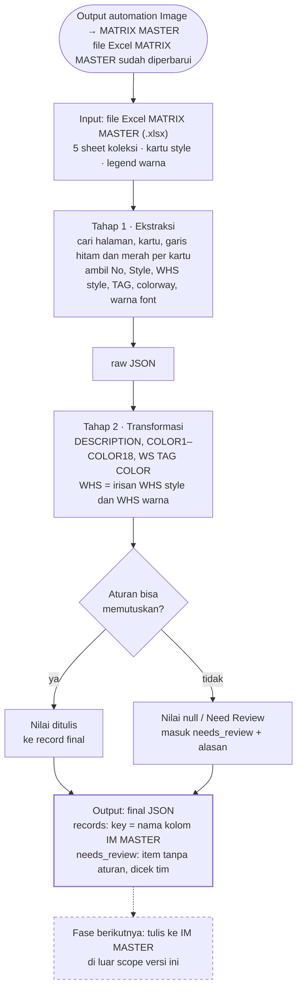

# PRD: MATRIX MASTER → JSON untuk IM MASTER

Tanggal: 9 November 2026 · AI Team · Revisi: 10 November 2026 (hasil review `needs_review`, lihat Riwayat perubahan)

## Ringkasan

Sistem ini membaca file Excel F27 MATRIX MASTER dan menghasilkan JSON siap pakai untuk IM MASTER: DESCRIPTION, COLOR1–COLOR18, WS TAG COLOR, dan WHS untuk setiap colorway. Versi ini berhenti di JSON; penulisan ke IM MASTER adalah fase berikutnya.

Saat ini kolom warna dan WS TAG COLOR di IM diisi manual dari MATRIX MASTER. MATRIX berbentuk kartu style, dan banyak artinya disimpan sebagai warna font, warna background, dan garis border, bukan teks.

Sistem berjalan setelah automation Image → MATRIX MASTER selesai memperbarui file, dalam dua tahap: **Ekstraksi** (Excel → raw JSON) dan **Transformasi** (raw JSON → final JSON + antrian review). Prototipe kedua tahap sudah diuji pada file F27.

## Tujuan dan non-goals

Tujuan versi ini:

1. Membaca semua kartu style di semua sheet MATRIX MASTER tanpa bergantung pada nomor baris tetap, karena layout tiap halaman berbeda.
2. Menghasilkan raw JSON per style: No, Style, WHS style, TAG, dan colorway yang dikelompokkan menurut posisi garis hitam dan merah.
3. Menghasilkan final JSON per colorway dengan key yang sama persis dengan nama kolom IM MASTER.
4. Tidak menulis nilai tebakan: setiap data yang tidak bisa diputuskan aturan dikosongkan (null) atau, untuk WS TAG COLOR, diisi `Need Review`, dan masuk antrian review.

Di luar scope versi ini:

- Melengkapi jenis benang (prefix YCA/YST dan kode) di MATRIX MASTER. Ini dikerjakan automation lain, jadi nilai COLOR diambil apa adanya.
- Menulis ke file IM MASTER. Aturannya sudah disepakati dan dicatat di bagian Fase berikutnya.
- Mengubah file MATRIX MASTER.
- Kolom IM selain DESCRIPTION, COLOR1–COLOR18, WS TAG COLOR, dan WHS.

## Alur sistem



Sistem mulai bekerja setelah automation Image → MATRIX MASTER selesai memperbarui file Excel. Nilai yang tidak bisa diputuskan aturan tidak ditebak: nilainya dibiarkan null (WS TAG COLOR diisi `Need Review`) dan dicatat di `needs_review`.

## Input: file MATRIX MASTER

Inputnya satu file Excel MATRIX MASTER (.xlsx). Semua elemen dikenali dari teks label dan warnanya, bukan dari posisi baris, karena posisinya berubah di setiap halaman.

| Elemen | Cara mengenali | Kondisi di F27 |
| --- | --- | --- |
| Sheet | 1 sheet = 1 koleksi | 5 sheet: ESSENTIALS COTTON, ESSENTIALS GRASSY, GAME DAY, FALL, LUXE |
| Halaman | blok yang dimulai sel kolom A berawalan "FALL 27" | 30 halaman, tinggi 63–71 baris |
| Legend | baris 2–6 di setiap halaman | arti warna fill dan warna font |
| Kolom label | kolom berisi "- LEBAR/WIDTH", "- IM", "- YARN", dst. | posisinya pindah-pindah (kolom E, I, J, K, M) |
| Kartu style | setiap kolom di kiri kolom label yang punya nama style | 1–10 kartu per halaman |
| Sub-koleksi | teks kolom A tepat di atas baris nomor | mis. WINTER BEACH, CHRISTMAS - GRASSY; nomor mulai ulang dari 1 |
| Foto produk | gambar di atas nama style | tidak dipakai; membuat file berukuran 125 MB |

Satu kartu style, dari atas ke bawah:

1. **Nomor**: angka atau teks (S1, 1A). Warna background-nya menandai WHS style.
2. Foto produk.
3. **Nama style**: sel berbingkai tebal.
4. NEW / EXACT REPEAT, kadang diikuti baris koleksi.
5. **TAG**: instruksi tag, mis. "TAG: C1/C2 MARL".
6. **Colorway**: 1 sel = 1 colorway; benang dipisah "/" atau enter (C1, C2, …).
    - di atas garis hitam
    - di antara garis hitam dan garis merah
    - di bawah garis merah
7. Baris "L: … cm" dan atribut lain (tidak dipakai).

## Tahap 1: Ekstraksi (Excel → raw JSON)

Tahap ini membaca setiap kartu style dan menyalin isinya apa adanya, ditambah arti warna dari legend. Garis dideteksi per kartu, karena di beberapa halaman satu kartu punya garis di baris yang berbeda dari kartu lain.

| Field raw JSON | Aturan deteksi |
| --- | --- |
| `no` | nilai hasil formula di baris nomor; angka, atau teks seperti S1, S2 - A, 1A |
| `section` | teks kolom A tepat di atas baris nomor; null bila tidak ada |
| `style` | sel tepat di atas baris yang isinya persis NEW / EXACT REPEAT / REPEAT / UPDATE / REPEAT WITH UPDATE. Harus cocok persis, supaya nama seperti "NEWPORT …" tidak terbaca sebagai label |
| `style_whs` | warna background sel nomor: ungu (FF66FF) → 000; abu (theme −15% atau D9D9D9), putih (FFFFFF / theme putih), atau tanpa warna → 000 & SY; merah (FF0000) → SY; warna lain → null + warning. Kartu yang sel nomornya tidak ditemukan → null + warning |
| `tag` | sel di bawah nama style yang berawalan "TAG". TAG beberapa baris digabung dengan " \| ". Sel "TAG …" yang ada di area warna tidak dihitung sebagai colorway |
| garis hitam | border tebal (medium/thick) berwarna auto, indexed 64, theme 1, atau hitam |
| garis merah | border tebal berwarna merah (FF0000, E40500, C00000); kalau tidak ditemukan di kartu itu, dipakai baris garis merah mayoritas di halaman |
| colorway | setiap sel tidak kosong setelah baris TAG sampai sebelum baris "L: … cm". Sel yang hanya berisi tanda baca (mis. `.`, `` ` ``, `*`) diabaikan tanpa warning |
| `yarns` | teks colorway dipecah dengan "/" dan enter, urutan dipertahankan |
| `font_color` | arti warna font sesuai legend (lihat Lampiran) |
| `comment` | isi comment sel; sering berisi override tag atau daftar benang stripe |

Contoh raw JSON untuk satu style:

```json
{
  "no": 20,
  "style": "HUTTON MOCK T NECK CHUNKY",
  "style_whs": "000 & SY",
  "tag": "TAG: C1 (For Solid) | TAG: SNOW MARL (For PURE SNOW/ALMOND BUTTER)",
  "color_above_black_line": [
    {"colorway": "NIGHT NAVY", "yarns": ["NIGHT NAVY"], "font_color": "NEW COLOR", "cell": "C163", "comment": null}
  ],
  "color_between_black_and_red_line": [
    {"colorway": "PURE SNOW/ALMOND BUTTER", "yarns": ["PURE SNOW", "ALMOND BUTTER"], "font_color": "NEW COLOR", "cell": "C164", "comment": null}
  ],
  "color_below_red_line": [
    {"colorway": "BLACK", "yarns": ["BLACK"], "font_color": "REPEAT COLOR", "cell": "C171", "comment": null}
  ],
  "sheet": "ESSENTIALS GRASSY",
  "section": null
}
```

File raw JSON juga memuat `warnings` (masalah saat membaca file) dan `total_styles`.

## Tahap 2: Transformasi (raw JSON → final JSON)

Setiap colorway menjadi satu record. Key record sama persis dengan header IM MASTER baris 54, termasuk penulisan "COLOR 4" yang memakai spasi.

| Kolom IM (key) | Aturan |
| --- | --- |
| DESCRIPTION | nama style apa adanya, tanpa size; berlaku untuk semua size di IM |
| COLOR1 … COLOR18 | 1 benang = 1 kolom, nilai persis seperti di MATRIX. Benang yang berulang (stripe) ditulis sekali, sesuai urutan kemunculan pertama. Slot tanpa benang tidak dicantumkan |
| WS TAG COLOR | TAG tanpa awalan "TAG:", setiap Cn diganti nama warna benang ke-n (tanpa prefix YCA/YST/YTX/BJ/YP/POODLE dan tanpa kode). Alias BLACK B → BLACK; STRIPED → STRIPE; akhiran dobel dibuang. Diisi teks `Need Review` + review bila: TAG bersyarat atau singkatan; Cn melebihi jumlah benang; TAG kosong; TAG masih berisi instruksi yang belum diterjemahkan (`C(…)` tanpa nomor atau kata COLOR); atau COLOR colorway berupa deskripsi stripe/marl |
| WHS (kolom CE) | irisan WHS style dan WHS warna (tabel di bawah) |

WHS warna ditentukan dari posisi colorway dan warna fontnya. Garis hitam tidak memengaruhi WHS.

| Posisi colorway | Warna font | WHS warna |
| --- | --- | --- |
| di bawah garis merah | apa pun | SY |
| di atas garis merah | ungu (000 ONLY COLOR) atau pink (000 REPEAT COLOR) | 000 |
| di atas garis merah | hijau (NEW COLOR) atau hitam (REPEAT COLOR) | 000 & SY |
| apa pun | YR COLOR, HOLD COLOR FOR SY, DISCONTINUED COLOR FOR SY | null + review |

WHS final = irisan WHS style dan WHS warna, karena warna tidak bisa dijual di WHS tempat style-nya tidak dijual. Contoh: style 000 + warna 000 & SY → 000 (bukan masalah, tidak masuk review). Kalau irisannya kosong → null + review. Kalau WHS style tidak diketahui (warna background di luar legend) → dipakai WHS warna + review.

Struktur final JSON:

```json
{
  "target": "F27 IM MASTER (sheet F27, header baris 54)",
  "source": "F27 MATRIX MASTER",
  "rules": {"...": "ringkasan aturan di bagian ini"},
  "summary": {"total_records": 724, "WHS": {"...": 0}, "WS_TAG_COLOR_filled": 633, "WS_TAG_COLOR_need_review": 91, "WS_TAG_COLOR_null": 0, "needs_review_items": 91},
  "records": [
    {
      "DESCRIPTION": "JUDE T NECK CHUNKY",
      "COLOR1": "SIENNA",
      "WS TAG COLOR": "SIENNA",
      "WHS": "000",
      "_ref": "ESSENTIALS GRASSY No.21 | D166 | between_black_red"
    }
  ],
  "needs_review": [
    {"record": 61, "code": "TAG_CONDITIONAL", "DESCRIPTION": "ARIA V CHUNKY COTTON", "issue": "TAG kondisional / singkatan: perlu aturan khusus", "_ref": "..."}
  ]
}
```

Key yang diawali "_" adalah metadata. `_ref` menunjuk asal record di MATRIX (sheet, nomor, sel, posisi garis) dan tidak pernah ditulis ke IM. Nilai null berarti tidak ditulis. Teks `Need Review` di WS TAG COLOR sengaja ditulis ke IM supaya tim melihat kolom itu perlu dicek. Style yang muncul di dua sheet (mis. HUTTON di ESSENTIALS GRASSY dan LUXE) adalah kondisi normal: record tiap sheet dicatat terpisah dengan WHS masing-masing.

## Validasi dan antrian review

Setiap kali dijalankan, sistem memeriksa hasilnya sendiri dan mengumpulkan semua yang tidak bisa diputuskan aturan ke `needs_review`. Tidak ada nilai tebakan yang masuk ke `records`.

Pemeriksaan otomatis:

- Semua key di `records` ada di header IM MASTER baris 54.
- WHS hanya berisi "000", "SY", atau "000 & SY".
- Jumlah colorway di raw JSON sama dengan jumlah record di final JSON.
- Setiap kartu punya nomor, nama, TAG, dan minimal satu colorway; kalau tidak, masuk `warnings`.
- Setiap WS TAG COLOR berisi `Need Review` punya item `needs_review` dengan kode TAG_* atau COLOR_IS_DESCRIPTOR.
- Setiap nilai record berupa null atau teks tidak kosong tanpa spasi di tepi yang tidak diawali `=`.

Jenis item `needs_review` dan jumlahnya pada file F27:

| Jenis masalah (kode) | F27 | Penanganan |
| --- | --- | --- |
| TAG bersyarat atau pakai singkatan (`TAG_CONDITIONAL`) | 57 record | WS TAG COLOR `Need Review`; aturan definitif belum ada |
| TAG meminta Cn melebihi jumlah benang (`TAG_CN_OUT_OF_RANGE`) | 21 record | WS TAG COLOR `Need Review`; dicek tim |
| TAG masih berisi instruksi belum diterjemahkan, mis. `C(car)`, `GONDOLA color` (`TAG_UNRESOLVED`) | 7 record | WS TAG COLOR `Need Review`; dicek tim |
| COLOR berisi deskripsi, bukan nama benang, mis. "BLUSH CHAMPAGNE STRIPE" (`COLOR_IS_DESCRIPTOR`) | 6 record | COLOR ditulis apa adanya, WS TAG COLOR `Need Review`; comment MATRIX disertakan |
| TAG kosong (`TAG_EMPTY`) | 0 | WS TAG COLOR `Need Review` |
| WHS style tidak diketahui: warna background di luar legend (`WHS_STYLE_UNKNOWN`) | 0 | dipakai WHS warna |
| Irisan WHS style dan WHS warna kosong (`WHS_CONFLICT`) | 0 | WHS null |
| Warna font tanpa aturan WHS (`FONT_COLOR_NO_RULE`) | 0 | WHS null |
| Benang unik lebih dari 18 (`TOO_MANY_YARNS`) | 0 | 18 benang pertama ditulis |
| Warning ekstraksi (`EXTRACTION_WARNING`) | 0 | dicek tim |

Tidak lagi masuk review sejak revisi 10 November 2026: WHS warna yang diturunkan oleh batas WHS style (17 record di F27, nilai WHS tetap mengikuti style), dan style yang muncul di dua sheet (8 item HUTTON, record tiap sheet dicatat terpisah).

## Kebutuhan non-fungsional

- **Teknologi:** Python 3 + openpyxl. Workbook dibaca dua kali: sekali untuk formula dan format (warna, border, comment), sekali untuk nilai hasil formula (nomor style).
- **File sumber aman:** MATRIX MASTER hanya dibaca dan tidak pernah disimpan ulang.
- **Performa:** sekitar 7 detik untuk file F27 berukuran 125 MB (Tahap 1 sekitar 7 detik, Tahap 2 di bawah 0,1 detik). Foto produk tidak diproses.
- **Deterministik:** input yang sama selalu menghasilkan output yang sama, jadi sistem aman dijalankan ulang setiap kali MATRIX diperbarui.
- **Tahan perubahan layout:** tidak ada nomor baris atau kolom yang di-hardcode. Halaman baru tetap terbaca selama label ("- LEBAR/WIDTH", NEW/EXACT REPEAT, "TAG"), legend, dan garis tetap dipakai.
- **Output:** JSON UTF-8 tanpa escape karakter non-ASCII, berisi ringkasan jumlah dan daftar warning.
- **Komponen prototipe:** `extract_matrix.py` dan `export_json.py` (Tahap 1), `to_im_json.py` dan `final_json.py` (Tahap 2).
- **Pemicu:** dijalankan setelah automation Image → MATRIX MASTER selesai. Cara memicunya (manual, terjadwal, atau dipanggil langsung oleh automation tersebut) belum ditentukan.

## Fase berikutnya: penulisan ke IM MASTER

Final JSON dipakai oleh penulis IM MASTER (fase 2, sudah dibangun; lihat spec `docs/superpowers/specs/2026-11-10-tulis-im-master-design.md` dan README bagian "Menulis ke IM MASTER"). Aturan penulisannya sudah disepakati dan dicatat di sini supaya format JSON tidak perlu diubah.

Sudah disepakati:

1. Setiap record dicocokkan ke semua baris IM yang DESCRIPTION-nya "&lt;style&gt; - &lt;size&gt; …". Yang diisi hanya baris colorway; baris subtotal ("… - BOTH WHS", "… - 000 ONLY", "… - SHOPIFY ONLY") tidak diisi warnanya.
2. Semua grup size (X/S, S/M, M/L FAF, M/L FAH, X/L) mendapat daftar colorway yang sama, dengan urutan sesuai MATRIX.
3. Baris ke-1 sampai ke-N di setiap grup diisi colorway berurutan (N = jumlah colorway).
4. Kalau baris lebih dari N, sisa baris diisi colorway terakhir. Jumlah baris tetap, sehingga tangga harga WHLS LINE PRICE (+1 per baris) tetap utuh.
5. Kalau baris kurang dari N, baris ditambahkan di dalam grup, sebelum baris subtotal, dengan menyalin baris di atasnya. Formula dan range SUBTOTAL ikut menyesuaikan.
6. WS TAG COLOR ditulis ke kolom CD, yang header-nya dicocokkan dari baris pertama ("WS TAG COLOR"). WHS ditulis ke kolom CE, bukan kolom G.
7. Nilai null tidak ditulis, dan kolom formula tidak pernah disentuh.

Usulan yang masih menunggu konfirmasi:

- **Slot COLOR sisa:** slot di atas COLORn yang berisi benang lama dikosongkan, sedangkan slot berisi aksesoris (awalan "X", mis. XBP, XZIP) dibiarkan.
- **Label subtotal:** diturunkan dari kombinasi WHS warna. Semua 000 → "000 ONLY", semua SY → "SHOPIFY ONLY", campuran → "BOTH WHS".

Kondisi IM F27 saat ini: hanya 172 dari 1.068 grup size yang jumlah barisnya sudah sama dengan jumlah colorway. 733 grup kelebihan baris dan 163 grup kekurangan baris.

Catatan teknis: fungsi sisip baris di openpyxl tidak menggeser referensi formula, dan menyimpan ulang lewat openpyxl menghapus gambar serta aturan conditional formatting. Karena itu penulis IM memakai Excel (via `osascript`) hanya untuk menyisipkan baris, dan mengubah nilai sel langsung di XML sheet; openpyxl hanya membaca.

Status dan sisa pekerjaan setelah fase 2 dibangun:

- Penulisan lewat UI dan CLI sudah ada; detail rancangan, pengaman, dan batasan ada di spec di atas (§6 sampai §10).
- Masih menunggu uji terima manual oleh user (`docs/uji-terima-tulis-im.md`): identitas file dan riwayat versi di Google Drive setelah Excel menyimpan (spec §10.3), terlihatnya file `~$` dari PC lain (§10.4), akses dari PC Windows, dan dua penulis bersamaan.
- Masih terbuka: label subtotal otomatis (tidak diubah sampai diputuskan), penanganan khusus rujukan dari file lain, dan memasang server sebagai layanan otomatis di PC pusat.

## Open issues

Semua item ini sudah ditandai di `needs_review`, jadi sistem tetap bisa berjalan sambil menunggu keputusannya.

- [ ] Aturan definitif WS TAG COLOR untuk TAG bersyarat dan singkatan (57 record, sementara `Need Review`). Contoh: HUTTON "C1 (For Solid) | SNOW MARL (For PURE SNOW/ALMOND BUTTER)", ARIA "TAG for Heathered: C1 HEATHERED / For solids: C1".
- [ ] TAG yang meminta Cn melebihi jumlah benang (21 record, sementara `Need Review`): diperbaiki di MATRIX atau diberi aturan?
- [ ] TAG yang masih berisi instruksi belum diterjemahkan (7 record, sementara `Need Review`): TREE FARM `C1/C(car)`, TELLURIDE `C1/GONDOLA color`.
- [ ] COLOR berupa deskripsi stripe atau marl (6 record, WS TAG COLOR sementara `Need Review`): ambil daftar benang dari comment sel, atau tunggu automation pelengkap benang?
- [ ] Aturan WHS untuk warna font YR COLOR, HOLD COLOR FOR SY, dan DISCONTINUED COLOR FOR SY (belum ada di data F27).
- [ ] Konfirmasi dua usulan penulisan IM: slot COLOR sisa dan aksesoris, serta label subtotal otomatis.
- [ ] Fase 2: cara menulis record dari dua sheet untuk DESCRIPTION yang sama (mis. HUTTON) ke baris IM.
- [ ] Cara memicu sistem setelah automation Image → MATRIX MASTER selesai.
- [ ] Arti garis hitam. Garis ini tidak memengaruhi WHS, jadi saat ini hanya disimpan sebagai posisi di `_ref`.

Sudah diputuskan (revisi 10 November 2026): style yang muncul di dua sheet dicatat terpisah; background nomor putih/tanpa warna = 000 & SY (MERRY STRIPED).

## Kriteria penerimaan

Sistem dianggap siap kalau semua kriteria ini terpenuhi pada file F27:

1. Semua kartu style terbaca tanpa error pencarian label.
2. Jumlah colorway di raw JSON sama dengan jumlah record di final JSON.
3. Semua key di `records` sama persis dengan header IM MASTER baris 54.
4. WHS hanya berisi "000", "SY", atau "000 & SY".
5. Pembagian garis untuk HUTTON MOCK T NECK CHUNKY (No. 20) dan JUDE T NECK CHUNKY (No. 21) sama dengan tampilan di MATRIX.
6. 25 record yang dipilih acak cocok dengan sel aslinya di MATRIX.
7. Setiap nilai yang tidak bisa diputuskan aturan bernilai null (atau `Need Review` untuk WS TAG COLOR) dan punya item di `needs_review`.

Baseline F27 (setelah revisi 10 November 2026):

| Metrik | F27 |
| --- | --- |
| Kartu style | 215 (211 nama unik) |
| Colorway | 724: 158 di atas garis hitam, 390 di antara garis, 176 di bawah garis merah |
| WHS style | 86 "000 & SY", 70 "000", 59 "SY", 0 tidak diketahui |
| Warning ekstraksi | 0 |
| WHS final per record | 354 "000", 194 "000 & SY", 176 "SY" |
| WS TAG COLOR | 633 terisi, 91 `Need Review`, 0 null |
| needs_review | 91: 57 TAG_CONDITIONAL, 21 TAG_CN_OUT_OF_RANGE, 7 TAG_UNRESOLVED, 6 COLOR_IS_DESCRIPTOR |
| Waktu proses | sekitar 1,5 detik |

Baseline awal prototipe (9 November 2026): WHS style 85 / 70 / 59 / 1 tidak diketahui; 4 warning; WS TAG COLOR 646 terisi dari 724; needs_review 115.

## Lampiran: legend warna yang dipakai sistem

Arti setiap warna diambil dari legend di bagian atas setiap halaman MATRIX MASTER.

| Tempat | Warna | Arti di legend | Dipakai sistem untuk |
| --- | --- | --- | --- |
| Background sel nomor | ungu (FF66FF) | 000 ONLY STYLE | WHS style = 000 |
| Background sel nomor | abu (theme −15% / D9D9D9), putih, atau tanpa warna | tanpa penanda | WHS style = 000 & SY |
| Background sel nomor | merah (FF0000) | SY ONLY | WHS style = SY |
| Font colorway | hijau (00B050) | NEW COLOR | 000 & SY bila di atas garis merah |
| Font colorway | hitam / otomatis | REPEAT COLOR | 000 & SY bila di atas garis merah |
| Font colorway | ungu (FF00FF) | 000 ONLY COLOR | 000 |
| Font colorway | pink (FF99FF) | 000 REPEAT COLOR | 000 |
| Font colorway | ungu tua (9900FF) | YR COLOR | review (belum ada aturan) |
| Font colorway | merah (FF0000) | HOLD COLOR FOR SY | review (belum ada aturan) |
| Font colorway | biru (0066FF) | DISCONTINUED COLOR FOR SY | review (belum ada aturan) |
| Border | garis hitam tebal | — | pemisah posisi; tidak memengaruhi WHS |
| Border | garis merah tebal | — | colorway di bawahnya = SY |

## Riwayat perubahan

### 11 November 2026: fase 2, penulisan ke IM MASTER

1. Ditambahkan penulis IM MASTER: `matrix2im write` dan panel **Tulis ke IM MASTER** di UI (multi-sesi, satu penulis pada satu waktu). Aturan 1 sampai 7 di "Fase berikutnya" berlaku penuh.
2. Pengaman: cocokkan password ubah dengan hash `fileSharing`, cek file `~$`, cadangan bertanggal, deteksi perubahan file sejak rencana, verifikasi hasil, dan log JSONL (`matrix2im-log.jsonl`, tanpa password).
3. Sisip baris lewat Excel (baris utuh, `fill down` terbatas); nilai sel ditulis langsung di XML sheet. openpyxl tidak pernah menyimpan IM MASTER. Setting `insert_engine = "none"` hanya mengisi baris yang ada.
4. Regression F27 pada salinan uji AI TEST V2: 211 style tanpa dilewati; 184 sisipan (321 baris, 27 di grup 1 baris) dan 195 style IM tanpa data MATRIX. Angka ini berbeda dari perkiraan spike (177 / 286 / 179) karena grup kini juga dipecah saat DESCRIPTION berubah.
5. Dokumentasi: README bagian "Menulis ke IM MASTER" dan daftar uji terima `docs/uji-terima-tulis-im.md`.

### 10 November 2026: hasil review `needs_review`

1. Style yang muncul di dua sheet adalah kondisi normal. Record tiap sheet dicatat terpisah, dan item `DUPLICATE_STYLE_ACROSS_SHEETS` dihapus (−8 item di F27).
2. WHS warna yang diturunkan oleh batas WHS style bukan masalah, jadi item `WHS_CAPPED_BY_STYLE` dihapus (−17 item). Nilai WHS tidak berubah.
3. TAG bersyarat atau singkatan: WS TAG COLOR diisi `Need Review` (57 record), dan item review tetap.
4. TAG yang meminta Cn melebihi jumlah benang: WS TAG COLOR diisi `Need Review` (21 record). Hal yang sama berlaku untuk TAG kosong.
5. Background nomor putih atau tanpa warna = WHS style 000 & SY (MERRY STRIPED). Warning dan item `WHS_STYLE_UNKNOWN` untuk kasus ini hilang.
6. COLOR berupa deskripsi: COLOR ditulis apa adanya, WS TAG COLOR diisi `Need Review` (6 record), dan item review tetap.
7. Aturan baru `TAG_UNRESOLVED`: TAG yang setelah substitusi Cn masih berisi `C(…)` atau kata COLOR (instruksi belum diterjemahkan). WS TAG COLOR diisi `Need Review` (7 record). Kasus ini sebelumnya lolos tanpa review.
8. Sel yang hanya berisi tanda baca diabaikan tanpa warning (−3 warning).

Detail dampak tiap keputusan ada di `docs/catatan-keputusan-review.md`.
